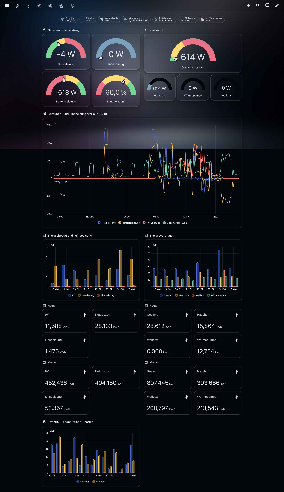
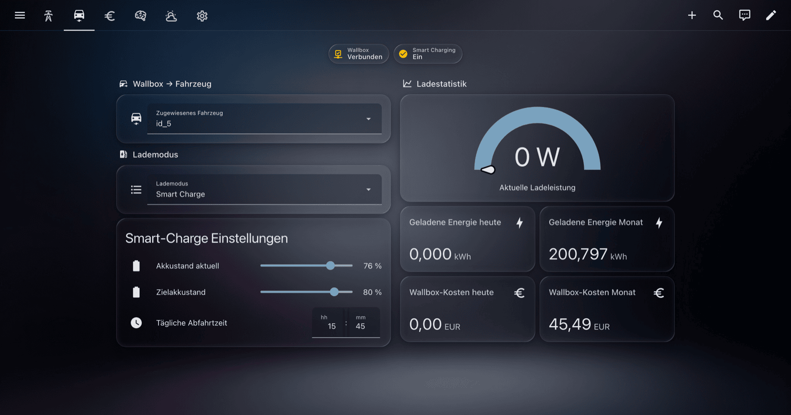
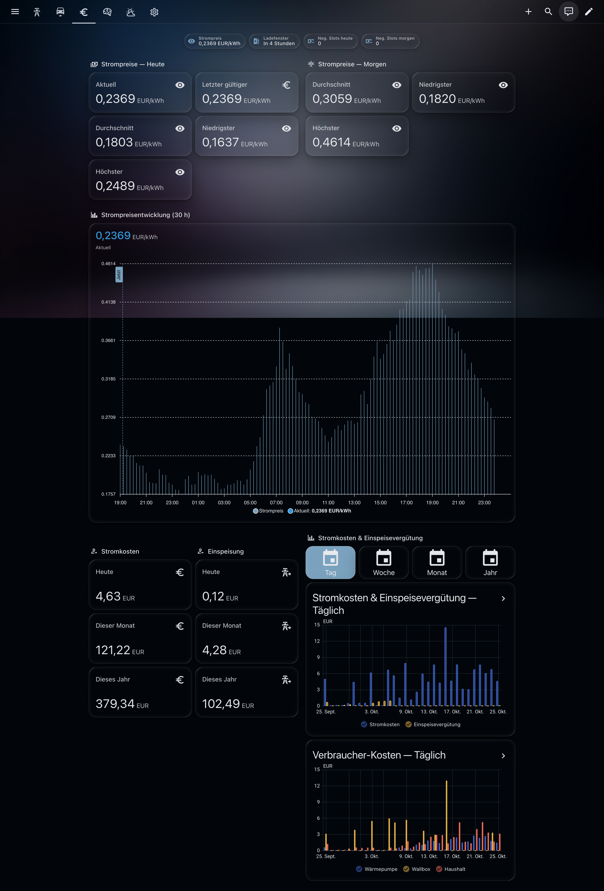
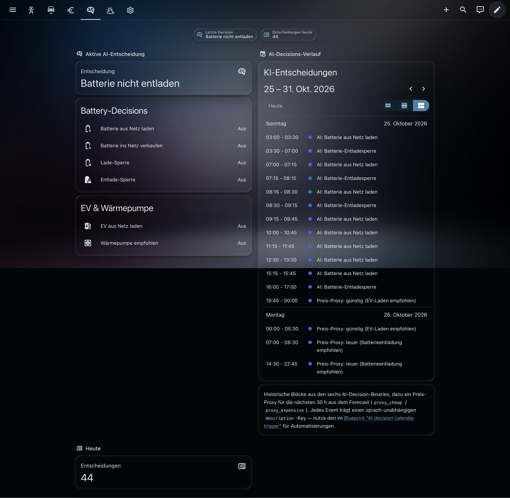
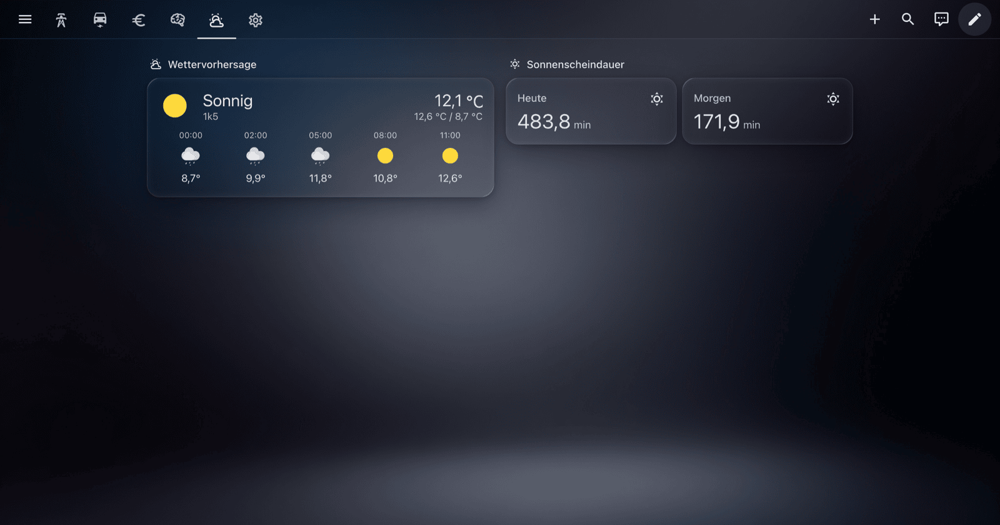
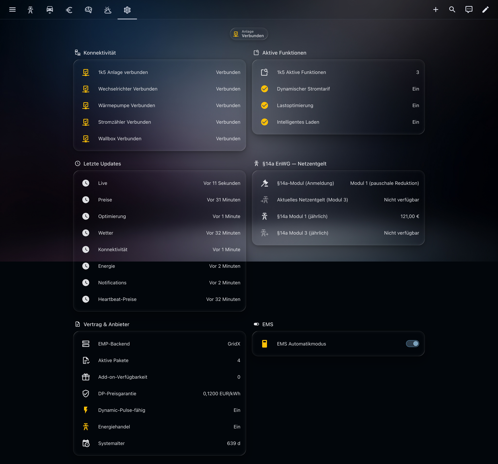

# 1KOMMA5° Home Assistant Integration

**1KOMMA5°** (also written **1komma5**, **1k5**) runs the **Heartbeat** energy platform for solar + battery + heat pump + EV wallbox setups. This is the Home Assistant integration for it, distributed via HACS at [github.com/mrebbert/1komma5-ha](https://github.com/mrebbert/1komma5-ha).

Dynamic electricity prices (dynamischer Stromtarif), 30-hour price forecast, AI optimization decisions, per-device cost allocation, cheapest-charging-window scheduling, weather forecast, and cloud push notifications, all as native HA sensors, services and bus events. Works on both 1KOMMA5°-backend accounts (`emp_type: "1K5"`, most newer installs) and legacy GridX-backed accounts (`emp_type: "GRIDX"`).

**📖 Full documentation: [mrebbert.github.io/1komma5-ha](https://mrebbert.github.io/1komma5-ha/)**

## Highlights

- ⚡ **60+ sensors** across 8 coordinators covering power, energy, cost, dynamic prices, AI decisions, weather, system health, §14a grid-fee reduction and contract overview
- 💶 **Dynamic tariff support** with 30-hour price forecast, cheapest-window sensors, and per-consumer cost allocation
- 🤖 **AI optimization events** — react to Heartbeat's grid-charge / heat-pump-recommend decisions in real time
- 🔔 **Cloud notification bridge** (v0.1.52) — drive automations from the same push notifications the 1KOMMA5° mobile app receives
- 🌍 **Seven locales** (DE, NL, FI, ES, DK, SE, AU) with per-market currency (EUR, DKK, SEK, AUD)
- 🏠 **Energy Dashboard-ready** out of the box; no template sensors, no manual wiring
- 📥 **Available in the HACS Default Store** — no custom repository setup needed

## Quick start

### 1. Install via HACS

This integration is in the **HACS Default Store** — no custom repository setup required.

1. Open **HACS** in Home Assistant
2. Search for **1KOMMA5°**
3. Click **Download**
4. Restart Home Assistant

One-click open:

Manual installation (without HACS)

1. Download the [latest release](https://github.com/mrebbert/1komma5-ha/releases/latest) (`onekommafive.zip`)
2. Extract and copy the `onekommafive/` folder to `<config>/custom_components/`
3. Restart Home Assistant

### 2. Add the integration

1. **Settings → Devices & Services → Add Integration**
2. Search for **1KOMMA5°**
3. Enter your 1KOMMA5° account e-mail and password
4. If your account has multiple systems, pick the one you want

Credentials are stored securely in the Home Assistant config entry. Sensors appear within seconds.

Full install, config-options and re-authentication / reconfigure flows: [Install & setup](https://mrebbert.github.io/1komma5-ha/install/).

## What you get

| Area | What it covers | Full page |
|------|----------------|-----------|
| Live power & battery | PV, battery (power + SoC), grid (bidirectional + split), household, EV charger, heat pump, AC, self-sufficiency — 30 s cadence | [docs](https://mrebbert.github.io/1komma5-ha/features/live-power/) |
| Dynamic pricing | Dynamischer Stromtarif, 15-min slots, 30 h forecast, cheapest-window sensors, negative-price counters | [docs](https://mrebbert.github.io/1komma5-ha/features/pricing/) |
| Energy & cost | kWh integration (Energy Dashboard-ready), per-consumer cost allocation, feed-in revenue, daily savings | [docs](https://mrebbert.github.io/1komma5-ha/features/energy-cost/) |
| §14a EnWG grid-fee | Modul 1 flat annual rebate + Modul 3 variable Netzentgelte HT/NT (both diagnostic, annual), plus `enwg14a_grid_fee_current` for the live per-slot Modul-3 rate (SDK 1.2.1+). Modul 1 sites see unavailable on the live sensor — Modul 1 has no per-slot component. | [docs](https://mrebbert.github.io/1komma5-ha/features/enwg14a/) |
| Contract overview | Active subscriptions, 1KOMMA5°Care add-on eligibility, EMP backend | [docs](https://mrebbert.github.io/1komma5-ha/features/contract/) |
| AI optimization | Six decision binaries, last-decision sensor, bus event, aggregated AI-decisions calendar (`calendar.<system>_ai_decisions_calendar`) with historical blocks plus a 30 h price-based proxy | [docs](https://mrebbert.github.io/1komma5-ha/features/ai-optimization/) |
| EV & wallbox | Per-vehicle controls (mode, SoC, departure), wallbox-to-vehicle assignment select | [docs](https://mrebbert.github.io/1komma5-ha/features/ev-wallbox/) |
| Weather | 48 h hourly forecast + sunshine totals | [docs](https://mrebbert.github.io/1komma5-ha/features/weather/) |
| Diagnostics | Per-coordinator timestamps, device-connectivity binaries, EMS auto-mode switch | [docs](https://mrebbert.github.io/1komma5-ha/features/diagnostics/) |

## Services & bus events

The integration registers four HA services (`get_cheapest_window`, `refresh_now`, `get_heartbeat_metrics`, `assign_ev_to_wallbox`) and three automation bus events (`onekommafive_notification`, `_optimization_decision`, `_negative_price_started/_ended`).

Full field tables and example automations: [Services & bus events](https://mrebbert.github.io/1komma5-ha/services/).

## Ready-made dashboards & automation blueprints

- **Dashboards** — [`dashboard/`](dashboard/) contains two ready-to-import Lovelace dashboards (energy & grid + EV charger). All cards are native HA types; the showcase dashboard needs `apexcharts-card`, `button-card` and the `input_select.stromkosten_zeitspanne` helper. See [dashboard README](dashboard/README.md).
- **Automation blueprints** — eleven importable blueprints in [`blueprints/automation/onekommafive/`](blueprints/automation/onekommafive/) covering cheapest-window scheduling, AI-decision notifications, universal calendar-driven triggers, EV-departure-time-from-calendar, PV-surplus charging, vehicle-at-wallbox binding and more. See [blueprints README](blueprints/automation/onekommafive/README.md).

Full tour: [Dashboards & blueprints](https://mrebbert.github.io/1komma5-ha/dashboards/).

Preview the six showcase views

| Grid (Netz) | Vehicle (Fahrzeug) | Prices & costs |
|-------------|--------------------|----------------|
|  |  |  |

| Optimization | Weather | System |
|--------------|---------|--------|
|  |  |  |

## Devices & entity structure

Entities are grouped under one system parent device plus per-asset sub-devices — one each for inverter, battery (split from inverter only when the asset model requires it), heat pump, smart meter, wallbox (one per physical wallbox since v0.1.58), vehicle. Sub-device data is PII-safe: only `manufacturer`, `model`, `firmware` from the cloud `status_and_assets` payload. `entity_id`s and `unique_id`s are stable across releases.

Full topology (including multi-wallbox) and PII guardrails: [Devices & entity structure](https://mrebbert.github.io/1komma5-ha/entity-structure/).

## Compatibility

- **Home Assistant** 2024.10 or newer
- A **1KOMMA5° account** with at least one active system
- The [`onekommafive`](https://github.com/mrebbert/1komma5-api) Python library (installed automatically)
- Seven supported markets: DE, AT, NL, FI, ES, DK, SE, AU (per-locale currency auto-detected)
- Authentication: OAuth2 PKCE against `auth.1komma5grad.com` (the current Auth0 flow). Accounts that still sign in only via `my.1komma5.io` are not supported; the EMP backend (GridX or 1KOMMA5°-native) is independent and both work.

End-to-end verification exists only for **Germany** — see [Compatibility](https://mrebbert.github.io/1komma5-ha/compatibility/) for the detailed caveat and the full technical details table.

## Known limitations

Three cloud-API realities the integration cannot design around (optimization binaries reflect the Cloud recommendation, not the HEMS; settlement fields stay empty; EMS auto-mode switch is likely cosmetic). Full detail: [Known limitations](https://mrebbert.github.io/1komma5-ha/limitations/).

## FAQ / troubleshooting

Common questions sit on [the FAQ page](https://mrebbert.github.io/1komma5-ha/faq/): HACS cache lag, `invalid_auth` + `my.1komma5.io`, EMS auto-mode switch unavailable, missing EV entities, Energy Dashboard wiring, §14a Modul 1 / Modul 3 semantics, `30401 /ems` log line, bug-report checklist.

## Contributing

For setup, PR workflow, code style and translation guidelines, see [CONTRIBUTING.md](CONTRIBUTING.md).

## Disclaimer

This project is **not affiliated with or endorsed by 1KOMMA5°**. The API is undocumented and may change without notice. This is an unofficial integration based on a reverse-engineered API, built 100 % vibe-coded with AI assistance. It may break if 1KOMMA5° changes their backend. Use at your own risk.
